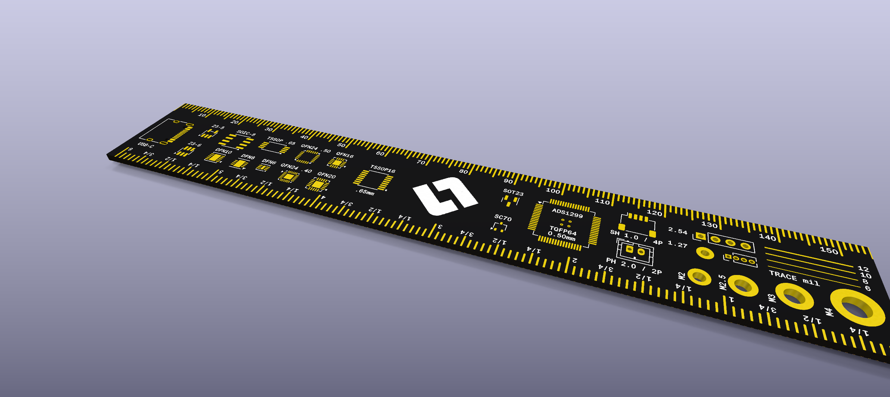

# Lovelace Ruler Studio

155 × 25 mm, 검정 솔더마스크·흰 실크·ENIG를 전제로 한 **편집 가능한 PCB 초안**.
ICRS 원본을 복사하고, 공개 자와 공식 풋프린트에서 모듈을 가져왔다. 패드·드릴·핀 피치를 축소하지 않는다.

**RULER-B rev B** — 이 저장소의 최종본이다. 앞면은 mm 눈금(위)·인치 눈금(아래)과 커넥터·IC 패키지, 뒷면은
ESP32-WROVER-E(AS-008 랜드)·XIAO ESP32S3·R/C/L·포고·간격 샘플·트레이스 폭과 뒷면 mm 눈금.




렌더는 부품 3D 모델 없이 맨 기판(검정 솔더마스크, 흰 실크, ENIG)이다. 다시 만들기: `./render.sh`.

앞면 mm 영점은 왼쪽 물리적 끝, 155 mm는 오른쪽 끝이다. 뒷면 mm 눈금은 앞면과 눈금 하나하나가 같은 x에 있다
(XIAO 아래 패드 열 밑에서만 5/10 mm 눈금 끝을 0.2 mm 띄웠다).
M2/M2.5/M3/M4는 각각 Ø2.2/2.7/3.2/4.3 mm **여유 홀**(ICRS DIN965 패드)이다.
ADS1299는 QFN과 분리한 TQFP-64 0.5 mm 샘플이다. XIAO는 제조사 25개 SMD 패드와 본체 외곽, WROVER는 주변 38개 패드와
중앙 접지 패드, 원본의 4개 열 비아를 포함한다. 실크 글자는 Figma에서 윤곽선으로 만든 그림이며 최소 0.15 mm(대부분 0.175 mm) 획이다.

## 실행과 편집

원래 [audiostream-esp32](https://github.com/chanulee/audiostream-esp32)의 `lovelace-ruler/`에서 분리했다.
AS 보드와 공유하던 실크 모듈은 `shared_silkscreen.py`, 웹 편집기는 `tools/`에 복사해 두었다.

```sh
python3 editor.py                                   # 웹 편집기 (KiCad Python으로 다시 실행됨)
```

Figma에서 편집하려면 [figma-pcb-extension](https://github.com/chanulee/figma-pcb-extension)의 브리지와 플러그인을 쓴다.

```sh
python3 ../figma-pcb-extension/bridge/figma_bridge.py --board lovelace-ruler.kicad_pcb
```

KiCad를 `/Volumes/KiCad`에 마운트한 상태에서 실행한다. 다른 설치는 `KICAD`에 앱의 `Contents` 경로 지정.
출력된 전체 URL로 접속한다. 기본 포트 8766.

- 앞/뒷면 전환, 확대/화면 맞춤.
- 검색 가능한 요소 목록, 드래그·X/Y·회전·삭제, 공식/원본 모듈 추가와 출처 확인.
- 텍스트 수정·추가, SVG 업로드와 위치·크기·회전 조정.
- 실행 취소 `⌘/Ctrl Z`, 다시 실행 `⇧⌘Z`/`Ctrl Y`, 저장 `⌘/Ctrl S`.
- 실행 취소는 최대 50단계 또는 약 16MB. 타이핑은 묶고 한 번의 드래그는 한 단계로 기록한다.
- 탭을 닫으면 미저장 변경은 사라진다.
- 저장은 **선택한 안의** PCB와 `silkscreen.json`에 반영된다. 원본 안을 덮어쓰지 않는다.
- 뒷면 X/Y는 보는 방향 기준이다. 구멍·관통 패드는 양면에 보이므로 다른 면의 부품과도 간섭할 수 있다.
- 하나의 가져온 모듈은 한 번만 놓이며, 이미 있으면 추가 버튼이 해당 요소를 선택한다.

풋프린트의 원본 패드/드릴 치수는 잠겨 있다. 변경하려면 KiCad에서 수정한다.
모듈과 설명 라벨은 별도 항목이므로 함께 옮길 때 둘 다 조정한다.
웹 글꼴은 근사값이다. 실제 인쇄·간섭 검사에서 KiCad 실크를 확인할 수 있다.

## 주문

주문 파일은 이 저장소에 들어 있다.

- `lovelace-ruler-gerbers.zip` (Gerber 7장 + PTH/NPTH 드릴, 같은 내용이 `release/`에)
- JLCPCB: 2층, 1.6 mm, 155 × 25 mm, **검정 솔더마스크 + 흰 실크, ENIG**. 부품 실장(BOM/CPL) 없음.
- 다시 만들기: `python3 build.py`(KiCad Python) 후 `./make_release.sh`

DRC는 `reports/drc.json`에 남긴다. 자라서 생기는 의도된 예외가 있다:
눈금 구리가 보드 가장자리까지 닿음, .10/.15 mm 간격 샘플, USB-C 원본 풋프린트의 겹친 패드,
1 mm 미만 핀 번호. 단락·관통 구멍 충돌·실크 겹침은 없다.

## 라이선스

보드 디자인은 [CC BY-SA 4.0](LICENSE), 스크립트는 [MIT](LICENSE-MIT).
ICRS(Apache-2.0), KiCad 공식 라이브러리(CC-BY-SA-4.0 + 예외), Adafruit(CC-BY-SA-3.0), Trace(MIT)에서 온
기하는 각자의 조건을 따른다. Seeed XIAO 풋프린트는 제조사 배포 파일로 명시적 라이선스가 없어 이 저장소의
라이선스 대상이 아니다. 자세한 내용: [NOTICE.md](NOTICE.md), [SOURCES.md](SOURCES.md).

## 원본과 재생성

- [SOURCES.md](SOURCES.md): 모듈별 출처·변환·라이선스와 참고 전용 저장소.
- `upstream/`: 가져온 원본, 리비전, 라이선스/출처 증거.
- `template-icrs.kicad_pcb`: 보존한 ICRS 기반 작업 템플릿.
- `template.kicad_pcb`, `native-components.json`, `assets/`: 공통 모듈 라이브러리.
- `silkscreen.json`: 최종 배치. `build.py`가 템플릿과 이것으로 `lovelace-ruler.kicad_pcb`를 만든다.

```sh
# KiCad Python으로 실행
python3 build.py --variant all
```

`import_icrs.py`는 원본 배치를 초기화한다. 평상시 실행하지 않는다.
`import_modules.py`는 소스 모듈을 다시 가져오며 상단의 /tmp 원본 경로와 KiCad 라이브러리가 필요하다.
`add_back_modules.py`는 뒷면 전용 모듈(뒷면 mm 눈금, 40/30/24/18 mil)을 템플릿에 다시 만든다.

## 제작 전 남은 항목

검정색은 미리보기/stackup에 반영했으며 주문 시에도 Black + ENIG를 선택한다.
전체 DRC는 아직 통과하지 않았다. 원본 눈금의 가장자리 구리/실크, USB-C의 원래 중복 패드,
의도적인 .10/.15 mm 갭과 .20 mm 비아, 라이브러리 경로 등을 제조 규칙에 맞춰 검토해야 한다.
현재 DRC 보고서는 `reports/`에 보관한다. 피치·패드·드릴 치수와 저장 왕복은 자동 테스트(`tests/`)로 확인한다.

QR은 주소 미정이라 `QR: URL TBD`, 전극 스냅은 치수 미정이라 `SNAP: SIZE TBD` 텍스트로 예약했다.
Ø1.5는 접점 지름 참고이며 touch-proof 커넥터의 패널 장착 홀 치수가 아니다.
NFC 회로/칩은 기본안에 없다. Trace의 NT3H2111 방식은 별도 칩과 조립이 필요하다.
전극·바이오센서 접속이나 동작을 검증하는 기판이 아니라 기계적 크기 참고용 자다.

일반 OSHW 기어는 인증 마크와 다르다. OSHW 정의를 충족하는 하드웨어에 사용한다.
Seeed XIAO 원본 파일에는 명시적 라이선스가 없어 이 저장소의 라이선스 대상에서 뺐다(NOTICE.md). OSHW 인증을 표시하지 않았다.

렌더: `renders/`.
